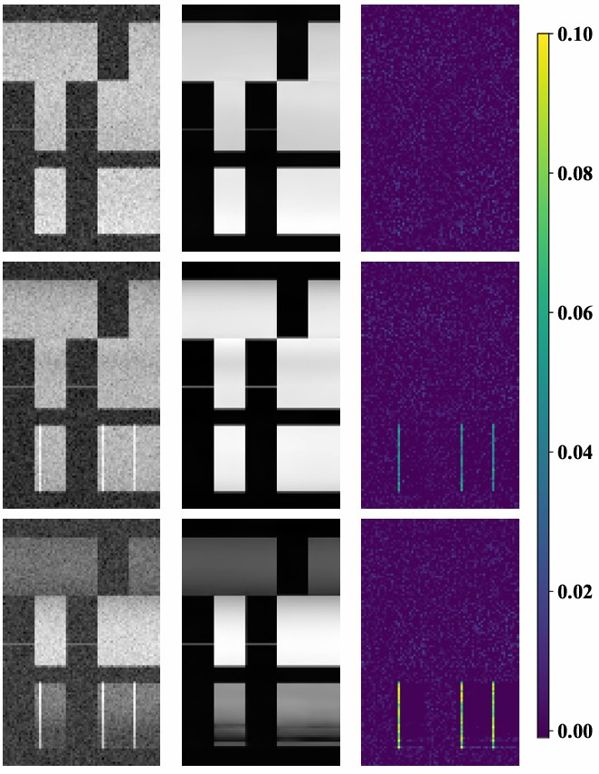

# Anomaly Detection

Here we implement and evaluate two approches for anomaly detection in OFDMA systems using our dataset.

<p>
  
</p>

---

# Dataset

Download the dataset from the following link:

 [](https://doi.org/10.5281/zenodo.20341906)

After downloading the dataset, extract the files and specify the path to the datasets folder (the folder that contains the numbered dataset folders, e.g. `3/`) in `../datapath.txt`. The dataset number is set by `dataset_nr` in `src/config.yml`; all scripts accept `-d <dataset number>` to override it.

---

# Installation

Clone the repository:

```bash
git clone https://github.com/akdd11/ofdma-spectrum-anomalies-simulation.git
cd ofdma-spectrum-anomalies-simulation/Example_Use
```

Install required dependencies:

```bash
pip install -r requirements.txt
```

---

# Training

To train the unsupervised (VAE) model, run:

```bash
python src/train_unsupervised.py
```

To train the supervised model, run:

```bash
python src/train_supervised.py
```

To exclude specific jammer types from the training set, use the --jammers_excluded argument followed by the names of the jammers you want to exclude:

```bash
python src/train_supervised.py --jammers_excluded 'jammer1' 'jammer2'
```

---

# Evaluation

To obtain anomaly scores for each jammer type using the selected detection method, run `src/Test.py` with the corresponding arguments.

For example, to evaluate the unsupervised method on barrage and deceptive jammers, run:

```bash
python src/Test.py --approach "unsupervised" --jammers 'barrage', 'deceptive'
```


The trained weights are provided in the `Example_Use/Weights` directory. 
You can use the jupyter notebooks provided to evaluate obtained anomaly scores (`Notebooks/Metrics.ipynb`, `Notebooks/Plots.ipynb`, which read the scores from `Anomaly_Scores`).
Additionally, you can visualize the anomalies detected by the VAE model for each sample (`Notebooks/Visualisation.ipynb`).

---

# Threshold-based Baseline

A non-learned energy detector is provided in `src/threshold_detector.py`. It uses the same input as the VAE, i.e., the spectrograms aggregated to RBs on the frequency axis. For every SU and time-frequency bin (RB x OFDM symbol), the power threshold is a quantile of the received power of the normal training samples (`split_unsupervised == "train"`). The anomaly score is the largest exceedance of this threshold map, z-normalized per SU on the normal validation samples and averaged over the SUs. The ROC curve and AUC per jammer type are computed on the test split as for the VAE. Run:

```bash
python src/threshold_detector.py --quantiles 0.5 0.9 0.95 0.99 0.999
```

The dataset is taken from the datasets folder given in `datapath.txt` of the repository root, with the dataset number `dataset_nr` from `src/config.yml` (override with `-d`). For every quantile, the ROC curve (PDF), the AUC per jammer type and jammer power, and the scores of the validation and test samples (e.g., to compute F1 with a threshold on the validation scores) are written to `Results/threshold` (relative to `Example_Use`, change with `--out_dir`). The spectrograms are loaded with the utilities in `src/utils/data_utils.py` of the repository root.


---

# Model Preference

We recommend the VAE model based on two key advantages:
* Its ability to generalize detection performance to previously unseen jammer types
* It's possible to localize jammers within a spectrum image for specific jammer types

