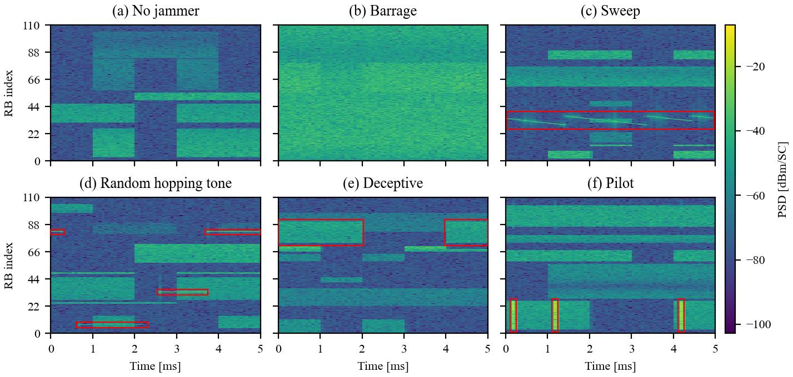
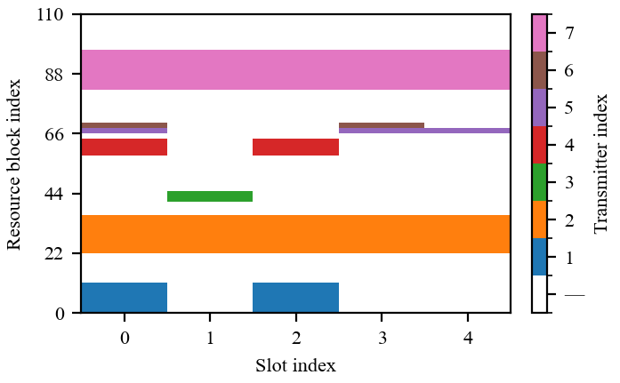

# OFDMA Spectrum Anomaly Simulation

## Abstract

This repository belongs to the paper "Spectrum Anomaly Detection in OFDMA Systems: Simulation Framework and Benchmark Dataset", available on arXiv: [arXiv:2606.02102](https://arxiv.org/abs/2606.02102). It provides a modular, open-source simulation framework for generating physics-driven datasets of spectrum anomalies in OFDMA systems. It combines Blender and the Mitsuba add-on for ray-traced channel generation with Sionna-based processing to produce labeled spectrograms suitable for training and benchmarking machine learning models for spectrum anomaly detection. The framework supports configurable scenarios (legitimate transmitters, jammers, varied propagation conditions), produces detailed labels for each sample, and includes scripts to reproduce dataset generation and evaluation, to enable reproducible research and quantitative comparison of anomaly detection methods.

The dataset is available for download at Zenodo:

 [](https://doi.org/10.5281/zenodo.20341906)

The three steps towards generating a dataset, namely scene generation, data generation, and creating image data and labels, are described in the following sections.

## Scene generation

The key of this simulation is a scene, in which ray tracing is executed to obtain channel frequency responses (CFRs) between transmitters and sensing units. The corresponding scene is created with a Python script in Blender, which creates the scene and exports it in a format that can be loaded by Sionna. The scene used to generate the dataset, together with the sensing units and a random set of legitimate transmitters and a jammer, is shown in the figure below.

<p align="center">
    
</p>

### Requirements

* Blender 4.2.19 LTS
* Mitsuba Add-on for Blender 0.4.0 (follow the installation instructions [here](https://github.com/mitsuba-renderer/mitsuba-blender))
* PyYAML in the Blender Python environment, to read the configuration file `blender-python/conf/scene_attributes.yaml`

<details>
<summary>Installing PyYAML in Blender</summary>

Run the following in the Blender `Scripting` tab:

```python
import subprocess
import sys

subprocess.check_call([sys.executable, "-m", "pip", "install", "PyYAML"])
```

</details>

### Usage

Open Blender and go to the Scripting workspace. Open the `blender-python/create_scenario_with_obstacles.py`. It creates a scene according to the specifications in `blender-python/conf/scene_attributes.yaml`. The scene is exported to a new folder `scenes/scene<N>` in the repository root, where `<N>` is the next free scene number, together with a `description.txt` and a copy of `scene_attributes.yaml`. The exported scene can then be loaded by Sionna to perform ray tracing; it is selected via `scene_nr` in `src/conf/dataset_generation.yaml`.

## Data generation

### Requirements

The datasets have been generated with Python 3.12.12 and Sionna (RT) 1.2.1 (Mitsuba 3.7.1, Dr.Jit 1.2.0) on Windows Server 2025 with an NVIDIA L40S GPU. The exact package versions of that environment are pinned in the file `requirements_simulation.txt`.

### Create custom intermediate data

Entry path for the simulation is the script `src/dataset_generation.py`, which executes the ray tracing and creates custom intermediate data. Simulation parameters can be configured in the file `src/conf/dataset_generation.yaml`. The dataset number and number of samples can also be configured via the command line, run with `-h` for details. The coordinates of the sensing units are specified in the file `src/conf/su_coordinates.yaml`.

The generated data is stored in the directory that is specified in the file `datapath.txt` which is located in the repository root. In this directory, a subdirectory with the specified dataset number is created, its content is described in [Dataset folder](#dataset-folder).

The samples are generated grouped by class, and the sample index (generation order) is the same in all output files. First come the normal samples, followed by one block per jammer type, in the order `deceptive`, `sweep`, `barrage`, `pilot`, `random_hop`. The number of samples per jammer type is `nr_samples * jam_probability / 5` (rounded down), the remaining samples are normal. With the default configuration (20000 samples, `jam_probability: 0.5`), samples 0-9999 are normal, followed by blocks of 2000 samples per jammer type (e.g., `deceptive`: 10000-11999, `random_hop`: 18000-19999).

All per-sample random draws (transmitter and jammer positions, resource allocation, payload, jammer waveform, noise) use the global NumPy RNG, seeded by `seed` in the config, and are reproduced exactly. The Sionna RT path solver samples its rays with a fixed seed as well, but on the GPU it is not bit-exact, so a regenerated dataset is identical up to small deviations, not bit-identical. The resolved configuration of each run, including the seed, command-line overrides and derived quantities, is saved as `config.yaml` in the dataset folder.

### Hardware impairments

The spectrograms contain receiver-side hardware impairments of the SUs (IQ imbalance, DC offset, and residual timing and LO frequency offsets), modeled as described in Sec. III-D2 of the [paper](https://arxiv.org/abs/2606.02102). The impairment parameters are drawn once per SU, held fixed for the whole dataset, and stored in `su_hardware.csv` in the dataset folder.

<details>
<summary>Configuration and implementation</summary>

The impairments are configured under the `impairments:` block in `src/conf/dataset_generation.yaml`. A master `impairments.enabled` switch gates all of them at once; each impairment also has its own `enabled` flag so individual impairments can be toggled independently. Since the hardware parameters are drawn with a dedicated RNG (seeded by `impairments.su_hardware_seed`), toggling impairments does not change any other random draw, i.e., with the same `seed`, an ideal and an impaired dataset contain the same scenarios (ideal-vs-impaired ablation).

Per SU, the impairments are applied in the following order: the received signal and jammer time signals (after the channel) are rotated by the LO frequency offset, and then the IQ imbalance is applied to them. The DC offset is added to the noise time signal. Finally, the STFT window is shifted by the timing offset. The models are implemented in `src/utils/impairment_utils.py`.

`su_hardware.csv` contains one row per SU, with the columns `timing_offset_samples`, `lo_freq_offset_ppm`, `dc_offset_over_noise_db`, `dc_offset_phase_rad`, `iq_gain_imbalance_db`, `iq_phase_imbalance_deg`, and `iq_irr_db` (derived, informational only). The file is always written with all drawn parameters, even if some or all impairments are disabled; which impairments were actually applied is recorded in the `impairments:` block of the `config.yaml` in the dataset folder.

</details>

### Create image data and labels

To further utilize the data, the script `src/custom_data_export.py` can be executed, which creates spectrograms and labels from the custom intermediate data. The dataset number can be configured via the command line, run `python src/custom_data_export.py -d <dataset_number>` to specify it. Two kinds of per-sample data are generated:
* Spectrograms per sensing unit (SU), one per sample and SU, with one pixel per resource element (RE), i.e., 1320 subcarriers × 70 OFDM symbols with the default configuration. They are clipped to a dataset-wide range (0.1st percentile of all values to 99.99th percentile of the jammed samples, see Sec. IV-B1 of the [paper](https://arxiv.org/abs/2606.02102) and `notebooks/analyze_clipping_percentiles.ipynb`) and scaled to 8 bit. The clipping bounds are computed per dataset and stored in `spectrogram_min_max.csv`; a pixel value $v$ corresponds to `min_val + v / 255 * (max_val - min_val)` in dB.
* Resource allocation grids, with the same resolution as the spectrograms (each RB and slot expanded to its REs), in which 0 corresponds to not allocated and any other value corresponds to the allocated transmitter index.

Both are stored as 8-bit PNG files in the subdirectory `images`.

<details>
<summary>Export to HDF5</summary>

With `--output-format hdf5` (default `png`), the spectrograms and resource allocation grids are instead stored in a single gzip-compressed file `dataset.h5`, with the same 8-bit values as the PNG files. It contains the datasets `spectrograms` (shape `(num_samples, num_su, num_freq_bins, num_time_bins)`) and `resource_allocations` (shape `(num_samples, num_freq_bins, num_time_bins)`), both of dtype `uint8` and indexed by the sample index.

</details>

#### Dataset folder

```
<datapath>/<dataset_nr>/
├── config.yaml              # resolved configuration of the generation run
├── su_coordinates.csv       # SU positions (su_idx, x, y, z in m), su_idx = SU index of the spectrograms
├── su_hardware.csv          # per-SU hardware impairment parameters, see Hardware impairments
├── custom/
│   └── samples-XXXX.pkl     # custom intermediate data, batches of batch_size samples
├── images/                  # --output-format png
│   ├── spectrogram-{sample_idx:05d}-{su_idx:02d}.png
│   └── alloc_res-{sample_idx:05d}.png
├── dataset.h5               # --output-format hdf5
├── labels.csv               # labels and data splits, one row per sample
└── spectrogram_min_max.csv  # clipping bounds, to rescale the 8-bit values to dB
```

#### Labels

`labels.csv` contains one row per sample, in the order of the sample index. Columns marked with `<su_idx>` exist once per SU. Jammer-related values are NaN for samples without a jammer, except for the SJR, which is `inf`.

| Column | Description |
|---|---|
| `jammer_type` | `"deceptive"`, `"sweep"`, `"barrage"`, `"pilot"`, `"random_hop"` (random hopping tone jammer), or `"no jammer"` |
| `jammer_power` | Transmit power of the jammer in dBm |
| `jammer_x`, `jammer_y`, `jammer_z` | Location of the jammer in the scene coordinate system in m |
| `num_legitimate_transmitters` | Number of legitimate transmitters in the scene |
| `jammer_occupancy` | Fraction of the resource elements (REs) occupied by the jammer (identical for all SUs) |
| `snr_by_su_<su_idx>` | Signal-to-noise ratio (SNR) in dB, over the whole time-frequency grid |
| `sjr_by_su_<su_idx>` | Signal-to-jammer ratio (SJR) in dB, over the whole time-frequency grid |
| `jsnr_local_by_su_<su_idx>` | Local jammer-to-signal-plus-noise ratio (JSNR) in dB, over the jammer-occupied REs |
| `db_contrast_global_by_su_<su_idx>` | Mean dB contrast caused by the jammer, over all REs |
| `db_contrast_local_by_su_<su_idx>` | Mean dB contrast caused by the jammer, over the jammer-occupied REs |
| `split_supervised`, `split_unsupervised` | `"train"`, `"valid"`, `"test"`, or empty if unused, see [Data splits](#data-splits) |

The jammer impact metrics (occupancy, local JSNR, dB contrast) are defined in [Jammer impact metrics](#jammer-impact-metrics).

#### Data splits

The dataset comes with a predefined train/valid/test split for supervised and unsupervised learning. With the default configuration, it reproduces the split used in the paper:

| | Supervised | Unsupervised |
|---|---|---|
| Normal train / valid / test | 5900 / 100 / 1000 | 8800 / 200 / 1000 |
| Anomaly train / valid | 5900 / 100 (1475 / 25 per type, without `random_hop`) | - |
| Anomaly test | 2500 (500 per type, including `random_hop`) | 2500 (500 per type) |

`random_hop` is excluded from the supervised training and validation sets, to evaluate the generalization to a jammer type unseen during training. Following the evaluation protocol of the paper (Sec. IV-C), a sample is labeled as anomalous if a jammer is present, irrespective of whether it is perceptible at every SU. Normalization statistics (e.g., mean and variance, or minimum and maximum) must be computed on the training or validation set only, never on the test set; for min-max normalization, a margin above the training maximum is recommended, since jammed samples can exceed the training range. The AUC is recommended as the primary metric.

<details>
<summary>Split rules and configuration</summary>

The assignments are computed by `src/custom_data_export.py` (`generate_dataset_splits` in `src/utils/data_utils.py`). The split is positional: within each class, the first `num_train_*` samples (by sample index) go to train, the next `num_valid_*` to valid, and the *last* `num_test_*` to test; samples in between remain unassigned (empty). Anomaly counts are divided evenly across the jammer types. The types in `left_out_types` (default `random_hop`) are only assigned to the test set. Since the test samples are taken from the end of each class for both protocols, both protocols share the same test set as long as their `num_test_*` counts match (as by default). The counts and `left_out_types` are configured under `split:` in `src/conf/dataset_generation.yaml`.

</details>

#### Jammer impact metrics

The SNR and the SJR are averaged over the whole time-frequency grid, which dilutes a jammer that only occupies a small part of it, such as the pilot jammer. The occupancy, the local JSNR, and the dB contrast describe the impact of the jammer on the REs it actually occupies; they are defined in Sec. IV-B3 of the [paper](https://arxiv.org/abs/2606.02102).

<details>
<summary>Definitions and notes</summary>

**Occupancy** $\rho$: the fraction of REs occupied by the jammer. It relates the grid-wide to the local quantities, approximately $\mathrm{SJR}_\mathrm{global} \approx \mathrm{SJR}_\mathrm{local} - 10 \log_{10}(\rho)$, and differs by orders of magnitude between the jammer types.

**Local JSNR**: compares the jammer to the background on the REs it occupies,

$$\mathrm{JSNR}_\mathrm{local} = 10 \log_{10} \frac{\overline{|J|^2}}{\overline{|S|^2} + \overline{|N|^2}},$$

where $S$, $J$ and $N$ denote the signal, jammer and noise contribution to the spectrogram. The averages of $S$ and $J$ are taken over the occupied REs, the noise power over the whole grid. Positive values indicate that the jammer dominates its own footprint.

**dB contrast**: the change of the spectrogram caused by the jammer, in the logarithmic domain of the spectrogram images,

$$\Delta = 20 \log_{10}|S + J + N| - 20 \log_{10}|S + N|.$$

`db_contrast_global` is the mean of $\Delta$ over all REs and corresponds to a mean-pooled anomaly score, `db_contrast_local` is the mean over the occupied REs. Since all spectrograms share the same clipping bounds, $\Delta$ corresponds to the same number of grey levels in every image (within the clipping range).

**NOTE**: The occupancy refers to the REs the jammer signal is generated on. Because of the finite analysis window, the visible footprint in the spectrogram can be somewhat wider (most notably for the pilot jammer, whose energy sits on isolated subcarriers).

</details>


### Load the data

As a starting point, the notebook `notebooks/plot_spectrograms.ipynb` shows how to load the generated spectrograms (and labels) and plot them.


#### Spectrograms

Below are example spectrograms at one SU each: (a) normal operation and (b)-(f) one example per jammer type (samples 1, 14001, 12016, 18002, 10004, and 16020 at SUs 16, 15, 7, 20, 7, and 14). The red boxes mark the regions occupied by the jammer; the barrage jammer covers the entire grid. Note that the provided images are in grayscale, but are shown here with a color scale for better visibility.

Besides the jammers, the hardware impairments of the SUs are visible (see [Hardware impairments](#hardware-impairments)): the residual DC offset as a horizontal line at the center subcarrier (RB 55, e.g., in (a) and (d)), and the image caused by IQ imbalance for very strong signals, mirrored at the center frequency (in (f), the pilot jamming in RBs 3-25 is mirrored to RBs 84-107). The sweep and random hopping tone jammers are generated block-wise and not aligned to the OFDM symbol grid, hence they exhibit spectral splatter, visible as faint vertical stripes in (c) and (d).

<p align="center">
  
</p>

#### Resource allocation

The notebook `notebooks/plot_resource_allocation.ipynb` shows how to load the resource allocation images.

**NOTE**: The resource allocation images are 8-bit PNG images, with the pixel value corresponding to the transmitter index (0: not allocated). Hence, the images seem almost completely black, but the information is still correctly contained in the images. For visualization below and in the paper, a discrete color scheme has been applied to highlight the allocations to the users.

The example below shows the resource allocation of sample 10004, i.e., the sample of the deceptive jammer example (e) above. The deceptive jammer occupies RBs 73-89 in slots 0, 1, and 4, i.e., the unallocated RBs 73-81 and the lower part of the band of transmitter 7 (RBs 82-96).

<p align="center">
  
</p>


### Paper figures

The figures of the paper (SNR/SJR distribution, resource allocation, and example spectrograms) are generated from the dataset with

```bash
python src/plot_figures.py
```

and saved as PDF into the `figures` folder. The script only uses the published data, i.e., the figures can be reproduced from the downloaded dataset.

<details>
<summary>Options and further figures</summary>

The output folder can be changed with `-o`. The resource allocation and example spectrogram figures are additionally saved as PNG into the `assets` folder (`--assets-path`), from where they are embedded in this README. Individual figures can be selected with `-f` (`snr_sjr`, `allocation`, `spectrograms`), another dataset with `-d`. The distributions of the jammer impact metrics (`occupancy_distribution.pdf`, `jsnr_local_distribution.pdf`, `db_contrast_*_distribution.pdf`) are created by the notebook `notebooks/plot_spectrograms.ipynb`. The regions occupied by the jammers, which are highlighted in the example spectrograms, are not contained in the dataset; they are inferred from the spectrograms and resource allocation images (see `src/utils/jammer_footprint.py`).

</details>


### Documentation

Generate the documentation for the simulation framework from the root of the repository with the following command:

```bash
pydoctor --config pydoctor.ini
```

`pydoctor` is not part of `requirements_simulation.txt` and needs to be installed separately (`pip install pydoctor`).

## Detection

The baseline models for supervised and unsupervised detection are not required to generate the dataset and are therefore provided separately in the `Example_Use` folder, together with its own [README](Example_Use/README.md). They serve as a starting point for further development and as a benchmark for future research on spectrum anomaly detection in OFDMA systems.

## Citation

If you are using the code or dataset in this repository, please cite the following paper:

```bibtex
@misc{schoesser2026spectrumanomalydetectionofdma,
      title={Spectrum Anomaly Detection in OFDMA Systems: Simulation Framework and Benchmark Dataset}, 
      author={Anton Schösser and Mohammadhadi Salehi and Sinuo Ma and Philipp Schulz and Gerhard Fettweis},
      year={2026},
      eprint={2606.02102},
      archivePrefix={arXiv},
      primaryClass={eess.SP},
      url={https://arxiv.org/abs/2606.02102}, 
}
```
